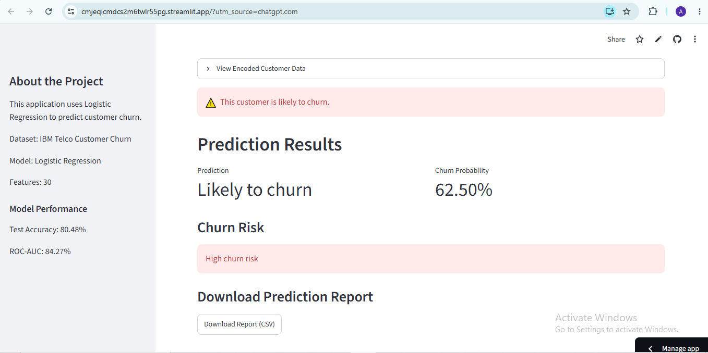

🚀 **Live Demo:** [Try Customer Churn Prediction](https://cmjeqicmdcs2m6twlr55pg.streamlit.app/)

# Customer Churn Prediction

A Machine Learning project that predicts whether a telecom customer is likely to churn.

## Application Screenshot



## Project Overview

Customer churn refers to customers leaving a service provider.

This project uses the IBM Telco Customer Churn dataset to analyze customer behavior and build a machine learning model that predicts customer churn.

## Exploratory Data Analysis (EDA)

The IBM Telco Customer Churn dataset was analyzed to understand customer behavior and identify patterns associated with churn.

Key observations:

- **Contract type:** Month-to-month customers showed higher churn than customers with longer-term contracts.
- **Internet service:** Fiber optic customers showed higher churn in the analyzed dataset.
- **Payment method:** Customers using electronic check showed higher churn.
- **Tenure:** Customers with shorter tenure were more likely to churn.
- **Technical support:** Customers without technical support showed higher churn.
- **Online security:** Customers without online security showed higher churn.

These findings describe associations observed in the dataset and do not establish causation.

## Dataset

Dataset: IBM Telco Customer Churn

The dataset contains customer information such as:

- Customer demographics
- Tenure
- Monthly charges
- Total charges
- Contract type
- Internet service
- Payment method
- Technical support
- Online security
- Streaming services

## Technologies Used

- Python
- Pandas
- NumPy
- Matplotlib
- Seaborn
- Scikit-learn
- Joblib
- Streamlit
- Jupyter Notebook

## Machine Learning Model

The project compares multiple machine learning models:

- Logistic Regression
- Decision Tree
- Random Forest

The Logistic Regression model was used in the Streamlit application.

## Model Performance

Test Accuracy: 80.48%

ROC-AUC: 84.27%

## Streamlit Application

The application allows users to:

- Enter customer information
- Predict customer churn
- View churn probability
- View churn risk level
- View probability comparison
- Download a prediction report as CSV
- Start a new prediction

## Project Structure

```text
Customer_Churn_Project/
│
├── data/
│   └── Telco-Customer-Churn.csv
│
├── notebooks/
│   └── Customer_Churn_Analysis.ipynb
│
├── models/
│   ├── churn_model.pkl
│   └── feature_names.pkl
│
├── app.py
└── README.md
